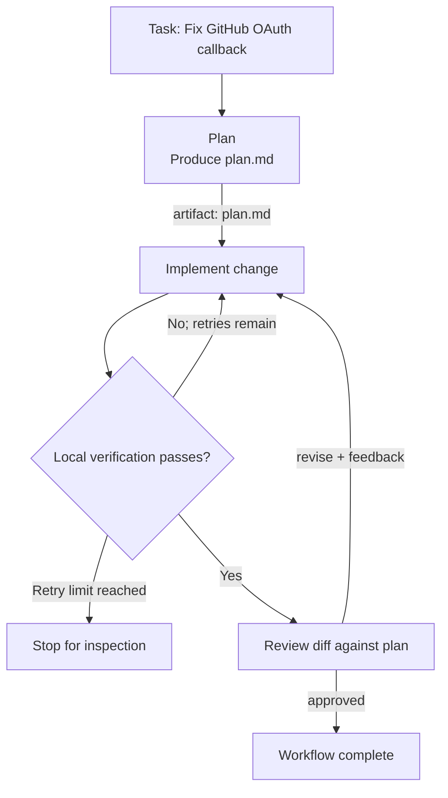

# Migent

<p align="center">
  <strong>Stop babysitting AI coding agents. Run autonomous, repeatable engineering pipelines right in your repo.</strong>
</p>

<p align="center">
  <a href="https://www.npmjs.com/package/@nodeint/migent"></a>
  <a href="https://github.com/nodeint/migent/blob/main/LICENSE"></a>
  <a href="https://nodejs.org"></a>
</p>

Migent turns the coding-agent CLIs you already use into **reusable, multi-stage engineering workflows**. Instead of manually handing a plan from one agent to another, pasting test failures into a new conversation, and hoping the final result was checked, you define the process once and let Migent coordinate the handoffs, verification commands, review decisions, and session state.

> **Recommended path:** install the Migent Skill, then ask your coding agent to set up and run Migent in your repository. You can start without learning the workflow schema or memorizing CLI flags.

## On this page

- [Quickstart: agent-assisted setup](#quickstart-let-your-coding-agent-set-it-up)
- [What Migent solves](#what-migent-solves)
- [How it works](#how-it-works)
- [Manual setup](#prefer-configuring-it-yourself-use-the-terminal)
- [Configuration by example](#configuration-by-example)
- [Capabilities and workflow patterns](#capabilities-that-matter-in-real-engineering-work)
- [Documentation and development](#documentation)

## Quickstart: let your coding agent set it up

**Prerequisites:** Node.js 22+, at least one supported agent CLI installed and signed in, and a coding agent with access to your repository.

### 1. Install Migent

```bash
npm install -g @nodeint/migent
```

### 2. Install the Migent Skill in your repository

Run this from the repository root:

```bash
migent skill install
```

This creates `.agents/skills/migent/`. The Skill gives compatible coding agents Migent's workflow schema, CLI commands, and recovery guidance, so they can use the tool correctly instead of guessing at its configuration.

### 3. Ask your agent to configure and run a workflow

Open a compatible agent in the repository. Give it your issue description or ask it to work on a feature, then use a prompt like this:

```text
Set up Migent for this repository:
- Use Claude for planning
- Use Codex for implementation
- Use Grok for code review

Create and run a workflow to solve this task:
<paste issue description here>

Before running it:
1. Inspect the repository and read the installed Migent Skill.
2. Create the required files under .migent/.
3. Validate the setup with `migent doctor` and fix configuration errors.
4. Run the workflow and report the session ID, verification results, and any blockers.
```

The agent should inspect the repository, consult the Skill, create `.migent/config.yaml` and the workflow YAML, validate the setup, and launch the session. Review the generated configuration and proposed commands before allowing changes to a production codebase.

**Why this is recommended:** Migent is designed to make engineering workflows repeatable, not to make developers memorize another configuration format. Let the agent handle the initial setup; inspect or edit the YAML directly when you need more control.

---

## What Migent solves

Using multiple coding agents can improve coverage—one agent can plan, another can implement, and another can review. But without orchestration, the developer becomes the glue between them.

| Without Migent | With Migent |
| --- | --- |
| **Manual handoffs** — copy plans from one conversation and paste errors or review notes into another. | **Declared handoffs** — stages receive their upstream artifacts, verification results, and routed review feedback. |
| **Context bloat** — one long conversation accumulates irrelevant history and loses track of constraints. | **Role-based stages** — each stage runs with the context and artifacts declared for that part of the work. |
| **“Looks good to me” reviews** — an agent says the task is done without running the repository's real checks. | **Verification gates** — configured local commands must pass before the workflow advances. |
| **Start over after interruption** — rate limits or network failures derail a long task. | **Recorded sessions** — inspect a run and continue a stopped or interrupted session instead of reconstructing it from scratch. |
| **One-off prompts** — the process depends on remembering how to run it each time. | **Process as code** — keep the team's engineering workflow in the repository and reuse it across tasks. |

Migent does not make model output inherently correct. It makes the process around that output explicit, repeatable, and verifiable.

## How it works

A typical workflow has four parts:

1. **Plan:** a planner turns the task into an implementation plan, for example `plan.md`.
2. **Implement:** a coder follows the plan and makes changes in the working repository.
3. **Verify:** Migent runs the project's real commands, such as `pnpm test`, `pytest`, or `cargo test`.
4. **Review:** a reviewer inspects the change against the plan and relevant risks, then approves it or routes feedback back to implementation.

The workflow author decides which stages exist, what they depend on, which artifacts are passed between them, what commands must pass, and what happens after a decision. This is a configurable pattern, not a hard-coded four-step lifecycle.

### Pipeline in action

For example, imagine a task to fix state validation in a GitHub OAuth callback. The plan is written once, implementation is checked by the repository's tests, and review feedback can send the change back for revision.



The important part is not the number of agents. It is the **control flow around the work**: defined inputs, explicit handoffs, real checks, review decisions, and a recorded session. If verification keeps failing, the workflow stops for inspection rather than retrying forever. If review requests changes, the feedback is routed back to the implementation stage.

## Core concepts

Migent separates **what a stage does** from **which model runs it** and **how the workflow progresses**.

| Concept | Meaning | Example |
| --- | --- | --- |
| **Workflow** | A reusable engineering pipeline stored under `.migent/workflows/`. | `feature.yaml` |
| **Stage** | One unit of work, with a role, instructions, dependencies, checks, or decision rules. | `implement` |
| **Role** | The purpose of a stage; workflows reference roles instead of hard-coding a model. | `planner`, `coder`, `reviewer` |
| **Model** | The configured provider CLI, model ID, and options used by a role. | Claude assigned to `planner` |
| **Artifact** | A named file published by one stage and consumed by another. | `plan.md` |
| **Decision route** | A branch based on a stage's decision. | `revise` routes back to `implement` |
| **Session** | The recorded execution of a workflow, including state and artifacts. | `.migent/sessions/<session-id>/` |

This separation lets you change the model behind a role without rewriting every workflow, provided the replacement is supported by the configured provider CLI.

## Supported agent CLIs

Migent drives local agent CLIs rather than requiring you to manage a separate API integration for each provider. Sign in through each provider's own CLI first; Migent runs those tools headlessly in your workspace.

| Provider | CLI | Example role in a workflow |
| --- | --- | --- |
| **Google Antigravity** | `agy` | Architecture planning, repository analysis, code review |
| **Anthropic Claude** | `claude` | High-reasoning design, implementation, refactoring |
| **OpenAI Codex** | `codex` | Implementation, test authoring, focused changes |
| **xAI Grok** | `grok` | Independent review and logic checks |

These are possible role assignments, not a ranking of the providers. Choose models based on your task, constraints, and what is available through your installed CLI.

---

## Prefer configuring it yourself? Use the terminal

The agent-assisted route is recommended, but you can also create and run workflows manually.

### 1. Initialize a starter workflow

```bash
migent init --preset plan
```

The `plan` preset guides you through model and role configuration and creates a starter workflow for the command below. Inspect the generated files under `.migent/` before adapting them to your project.

### 2. Run a task

```bash
migent session run --workflow plan --task "Design and implement the account settings flow"
```

Replace `plan` with the workflow ID you want to run.

### 3. Inspect or resume a session

```bash
# List workflow sessions
migent session list

# Continue a stopped, blocked, or interrupted session
migent session continue <session-id>
```

Sessions are stored under `.migent/sessions/<session-id>/`. They provide a record of what ran and let you continue eligible sessions without rebuilding the run from the beginning.

> **Tip:** Run `migent doctor` after editing your configuration or workflow files. It validates the setup and checks whether configured provider CLIs are available on `PATH`. It does not verify that you are signed in to every provider.

---

## Configuration by example

Migent separates **who does the work** (`.migent/config.yaml`) from **how the work flows** (`.migent/workflows/<name>.yaml`). The examples below illustrate that separation; use model IDs and options supported by the CLIs installed on your machine.

### 1. Assign models to roles

In `.migent/config.yaml`, define the model configurations once, then point each role to its default model. Role instructions describe the expected work; they are not tied to one specific provider.

```yaml
schema_version: 2

models:
  planning-model:
    provider: claude
    model: opus

  implementation-model:
    provider: codex
    model: your-codex-model-id # Replace with a model ID supported by your installed Codex CLI

  review-model:
    provider: grok
    model: grok-4.7
    options:
      reasoning-effort: high

roles:
  planner:
    default_model: planning-model
    instructions:
      - Turn the task into an actionable implementation plan with relevant file paths.

  coder:
    default_model: implementation-model
    instructions:
      - Implement the approved plan and add or update tests.

  reviewer:
    default_model: review-model
    instructions:
      - Check correctness, security risks, edge cases, and adherence to the plan.
```

`opus` and `grok-4.7` are illustrative model IDs; confirm them against your installed CLIs. Replace `your-codex-model-id` with a model ID supported by your Codex CLI. `migent doctor` can help catch configuration issues, but cannot prove that a model will make a good decision or produce correct code.

### 2. Define the pipeline

In `.migent/workflows/feature.yaml`, stages reference roles and declare their dependencies, verification commands, and decision routes. In this example, only `plan.md` is published as an output artifact; code changes remain in the shared repository workspace.

```yaml
schema_version: 2
id: feature

stages:
  - id: plan
    role: planner
    instructions:
      - Analyze the existing authentication routes and write an implementation plan.
    produces:
      artifact: plan.md

  - id: implement
    role: coder
    depends_on:
      - plan
    instructions:
      - Implement the approved plan and add tests for the changed behavior.
    verify:
      - pnpm test
    max_verify: 3

  - id: review
    role: reviewer
    depends_on:
      - implement
    instructions:
      - Review the diff for correctness, security issues, edge cases, and plan adherence.
    decision:
      values: [approved, revise]
      routes:
        approved: complete
        revise: implement

outputs:
  - name: plan
    from_stage: plan
    artifact: plan.md
```

Replace `pnpm test` with the relevant test command for your repository. Add other project checks where appropriate, such as type checking, linting, or a production build. Verification commands are only as strong as the checks you configure.

**What this example demonstrates:**

- `plan` publishes a named artifact that the workflow can hand to a dependent stage.
- `implement` cannot advance until its configured verification succeeds, subject to `max_verify`.
- `review` returns either `approved` or `revise`; the latter routes the work back to implementation.
- The workflow exposes `plan.md` as a declared output, while source-code changes remain in the working tree.

The reviewer should evaluate the actual diff, not merely trust the implementation agent's summary. Inspect the session and working-tree changes before merging or deploying.

<details>
<summary><strong>How to adapt this workflow</strong></summary>

- **For a bug fix:** ask the planner to identify a reproducible failure and the most relevant regression test before implementation.
- **For a feature:** have the plan identify affected modules, data changes, API behavior, and acceptance criteria.
- **For a refactor:** work in bounded batches and run focused tests after each batch, followed by the broader suite.
- **For more rigorous checks:** add the commands your repository actually uses. Do not copy a generic command that does not exist in your project.
- **For a different model mix:** update the model mapping in `config.yaml` while keeping the role and workflow structure unchanged, as long as the provider CLI supports the selected model.

</details>

---

## Capabilities that matter in real engineering work

### Native CLI execution

Migent runs the agent CLIs already installed in your environment. The agents retain the tool access and repository permissions provided by those CLIs, including the ability to use local diagnostics and interact with the working tree. This avoids building a separate provider wrapper just to launch each agent.

### Verification gates

A stage can run the same commands a developer would run locally, such as tests or a build. Configure retry limits so repeated failures do not turn into an unbounded loop. A green command is evidence that the configured check passed—not proof that the change is bug-free.

### Review and revision loops

A reviewer can return a decision such as `revise`, routing work back to an earlier stage with review feedback. This turns review from a final comment into part of the workflow. The usefulness of the loop still depends on the quality of the review instructions and the checks around it.

### Recorded sessions and recovery

Each run is recorded under `.migent/sessions/<session-id>/`. When work is interrupted or blocked, inspect the session to understand its state and continue it when appropriate. Recovery does not mean every failure can be resumed automatically; provider limits, invalid configuration, or unresolved task ambiguity may still require intervention.

### Process as code

Workflow YAML lives alongside the project, so a team can review changes to the engineering process, keep them in version control, and reuse the same defined pipeline. Results can still vary because agents and external tools are not perfectly deterministic.

### Model-agnostic role assignment

Workflows reference roles rather than fixed model definitions. You can change which configured model powers a role without rewriting workflow logic, provided the new provider/model combination is supported by the local CLI and accepts the configured options.

---

## Real-world workflow patterns

The following are patterns you can configure for your repository—not built-in GitHub integrations. External actions, such as fetching an issue from GitHub, require an available CLI or agent tool and explicit workflow instructions.

### 1. Turn a bug report into a verified fix

**Use it when:** the bug is reproducible and the repository has a test command.

1. Give the workflow the bug report, reproduction steps, and relevant logs.
2. Have the planner identify the likely code path and propose a regression test in `plan.md`.
3. Have the coder reproduce the issue where possible, implement the fix, and add the regression test.
4. Run the repository's test command through `verify`.
5. Send a passing change to review; route `revise` feedback back to implementation.

**Result:** a recorded run, an implementation diff, and evidence from the configured tests. A successful test run does not replace reviewing the diff or checking the behavior in the target environment.

### 2. Take a feature from plan to reviewed change

**Use it when:** a feature spans several modules or has meaningful API, data, or security implications.

1. The planner writes a file-aware implementation plan with acceptance criteria and relevant edge cases.
2. A review stage can challenge the plan before implementation if you configure that gate.
3. The coder implements the accepted plan and adds tests.
4. Local checks run before the implementation is reviewed against the plan.
5. Review feedback routes changes back to implementation until the workflow reaches its configured outcome or needs intervention.

**Result:** a repeatable engineering process that preserves the plan and verification requirements instead of relying on a single broad prompt.

### 3. Refactor deprecated patterns with a saved report

**Use it when:** a migration affects many files and needs to be performed in bounded steps.

1. Ask the planner to define the target patterns, scope, and exclusion rules.
2. Refactor in bounded batches rather than changing the whole codebase in one pass.
3. Run focused tests after each batch and broader integration checks at the end.
4. Publish a migration report as a declared artifact if the workflow is configured to produce one.

**Result:** a repeatable migration process with explicit checks and a report artifact, rather than a one-off agent response. The exact report and stage behavior must be defined in your workflow; they are not automatic integrations.

---

## Documentation

| I want to… | Read |
| --- | --- |
| Define stages, dependencies, artifacts, and review routes | [Writing Workflows](https://github.com/nodeint/migent/blob/main/docs/workflows.md) |
| Configure providers, model IDs, roles, options, and fallbacks | [Providers and Model Configuration](https://github.com/nodeint/migent/blob/main/docs/providers.md) |
| Understand session state, artifacts, and recovery | [Sessions and State](https://github.com/nodeint/migent/blob/main/docs/sessions.md) |
| Find CLI commands, flags, JSON output modes, and exit codes | [CLI Reference](https://github.com/nodeint/migent/blob/main/docs/cli.md) |

## Development

Migent is built with TypeScript in a pnpm workspace:

```bash
pnpm install
pnpm build
pnpm test
pnpm migent --help
```

See [CONTRIBUTING.md](https://github.com/nodeint/migent/blob/main/CONTRIBUTING.md) for contribution guidelines.

## License

Migent is licensed under the [MIT License](https://github.com/nodeint/migent/blob/main/LICENSE).
