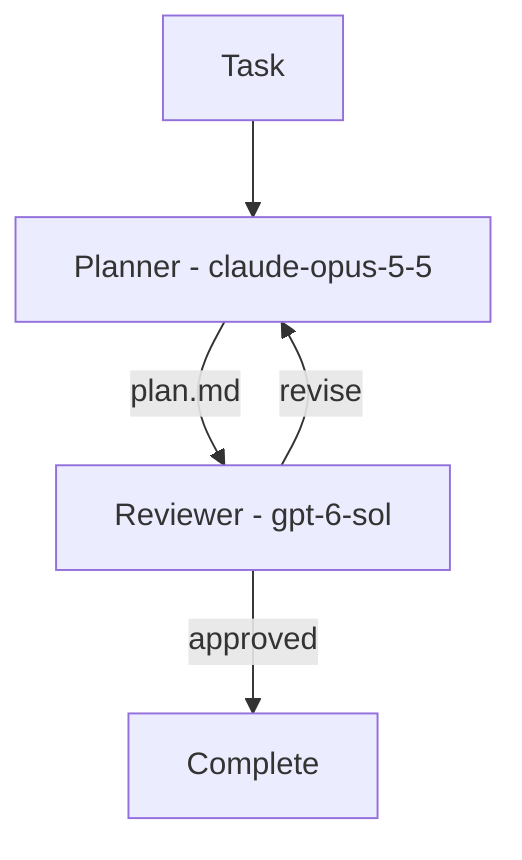

# Migent

<p align="center">
  <br>
  <strong>Compose AI coding agents into repeatable engineering workflows.
</strong>
</p>

<p align="center">
  <a href="https://www.npmjs.com/package/@nodeint/migent"></a>
  <a href="https://github.com/nodeint/migent/blob/main/LICENSE"></a>
  <a href="https://nodejs.org"></a>
</p>

---


Migent connects coding-agent CLIs from different providers through explicit,
repository-defined workflows. One model can plan, another can review, and the
first can revise—while Migent passes artifacts between them and tracks
the workflow's progress.

## Contents

- [Migent](#migent)
  - [Contents](#contents)
  - [Why Migent?](#why-migent)
  - [Supported CLIs](#supported-clis)
  - [Quickstart](#quickstart)
    - [With an AI agent](#with-an-ai-agent)
    - [Manually](#manually)
    - [Project files](#project-files)
    - [Tracking](#tracking)
  - [Workflow as code](#workflow-as-code)
    - [Start with one role and one stage](#start-with-one-role-and-one-stage)
    - [Add planning and review](#add-planning-and-review)
  - [Concepts](#concepts)
  - [Current scope](#current-scope)
  - [Documentation](#documentation)
  - [License](#license)

## Why Migent?

Calling two agent CLIs from a shell script is easy. Reliably coordinating them
across reviews, revisions, failures, and resumed sessions is not.

Migent is built around three ideas:

- **Use models for what they do best.** Assign each role to a provider and model
  suited to the work, rather than asking one agent to do everything.
- **Treat the engineering process as code.** Keep stages, handoffs, review gates,
  and revision policies in version control beside the project they govern.
- **Keep orchestration explicit.** The team defines the process; models execute
  roles inside it. A supervisor model does not invent or dynamically control
  the workflow.

**Roles define the work. Models carry it out.** Changing the model behind
a role does not require rewriting the workflow.

**Common workflow model, native provider capabilities.** Migent coordinates
the process, while each provider CLI remains responsible for authentication,
agent execution, and its own tools and options.



## Supported CLIs

Migent drives each provider through its headless CLI. Install and sign in to the
ones used by your configuration.

| Provider           | CLI          |
| -------------------| -------------|
| Google Antigravity | `agy`        |
| Claude             | `claude`     |
| Codex              | `codex`      |
| Grok               | `grok`       |
| BytePlus           | `opencode`   |
| OpenCode           | `opencode`   |

## Quickstart

Migent requires Node.js 22+ on macOS, Linux, or Windows. Install and sign in to
the provider CLIs you plan to use.

Install Migent first:

```bash
npm install -g @nodeint/migent
migent --version
```

Upgrade with `npm install -g @nodeint/migent@latest`.

Run setup from your project root, either with an AI agent or with the CLI.

### With an AI agent

1. Install the agent skill (requires Node.js 22.20+), then choose the AI
   clients to set up:

```bash
   migent skill install --project
```

2. Paste this prompt into your agent (Claude Code, Codex, Antigravity, Cursor,
   etc.):

```text
   Use the migent skill to set up Migent in this project.
```

   The agent handles setup. If you have provider or model preferences, specify
   them for the developer, planner, or reviewer role.

3. Ask the agent to write and review a plan for your task (optional):

```text
   Use the migent skill to run the plan workflow for this task: <Describe your task here>.
```

4. Ask the agent to implement the plan and review the changes (optional):

```text
   Use the migent skill to run the implement workflow with this plan: <Path to your plan file>.
```

### Manually

1. Run `migent init` and choose the provider, model, and options for the developer and
   reviewer:

```bash
  migent init
```

2. To let an AI agent operate Migent, install the skill separately
   (requires Node.js 22.20+):

```bash
 migent skill install
```

3. Write and review a plan for your task (optional):

```bash
migent session run --workflow plan --task "<Describe your task here>"
```

4. Implement the plan and review the changes (optional):

```bash
migent session run --workflow implement --task "<Path to your plan file>"
```

### Project files

After setup, your project contains:

```text
.migent/
├── config.yaml        # developer, planner, reviewer: models and instructions
├── .gitignore         # keeps run history and local overrides out of Git
└── workflows/
    ├── implement.yaml # implement and review a task
    └── plan.yaml      # write and review a plan
```


Commit these files to share the setup. Run history is saved in
`.migent/sessions/` when you start a task. If you install the skill, it lives
in your chosen AI client's skills directory.

### Tracking

Migent shows progress as it runs. A successful run ends with `completed`;
workflows that publish files also print their paths.

Each run is a session. Open another terminal in the project root to find
active sessions and inspect one:

```bash
migent session list --status active
migent session show <session-id>
```

`show` prints the current status, running stages, latest decisions, blockers,
and published outputs. To watch live stage events and provider activity, run:

```bash
migent session follow <session-id> --exit-when-done
```

The watcher exits when the session completes, is blocked, or is cancelled.
Press Ctrl+C to stop watching; the workflow keeps running in its own terminal.
Use `migent session list` to include stopped sessions, then resume one with:

```bash
migent session continue <session-id>
```

Session files are saved under `.migent/sessions/`. A typical workflow session
contains:

```text
.migent/sessions/<session-id>/
├── manifest.yaml              # session identity and workflow
├── workflow.frozen.yaml       # workflow and role settings used by this run
├── task.md                    # original task
├── status.json                # current status, stages, and decisions
├── events.jsonl               # session event history
├── outputs/                   # published workflow results, when available
└── executions/
    └── <order>-<stage-id>--attempt-<n>/
        ├── execution.json     # stage attempt status and metadata
        ├── stream.jsonl       # provider activity and heartbeats
        ├── prompt.md          # prompt sent to the agent
        ├── response.md        # saved agent response, when available
        └── artifacts/         # files produced by this stage
```

Read responses and artifacts to inspect the work behind each stage. Use the
CLI to manage session state. See [Sessions](docs/sessions.md) for the full
layout and recovery commands.

## Workflow as code

Workflows live in `.migent/workflows/`. Roles live in `.migent/config.yaml`.
A role names a kind of work and selects a provider and model. A stage assigns
work to a role; a workflow connects those stages.

### Start with one role and one stage

The following examples show how to write custom workflows. `migent init`
generates the workflows described in the quickstart.

Set the role's provider and model in `default_model`. Use model IDs available
from `migent provider list` in place of the example IDs.

```yaml
# .migent/config.yaml
schema_version: 4
roles:
  developer:
    default_model:
      provider: codex
      model: gpt-5
```

This workflow asks the developer to implement a task, then checks the result:

```yaml
# .migent/workflows/implement.yaml
schema_version: 4
stages:
  - id: implement
    role: developer
    instructions:
      - Implement the task described in task.md.
    verify:
      - pnpm build
      - pnpm test
```

Replace the `verify` commands with your project's build and test commands.
Run it with `migent session run`, as in the quickstart:

```bash
migent session run --workflow implement --task "Add a --json flag to the export command"
```

If verification fails, Migent asks the agent to fix the problem and checks again.

To change the developer's provider or model, edit its `default_model`. The
workflow still refers to `developer`. After editing configuration or workflows,
run `migent doctor` to check them.

### Add planning and review

For a plan-and-review workflow, define two roles. They can use the same model
or different providers:

```yaml
# .migent/config.yaml
schema_version: 4
roles:
  planner:
    default_model:
      provider: codex
      model: gpt-5
  reviewer:
    default_model:
      provider: grok
      model: grok-4
```

The planner produces `plan.md`. The reviewer receives it through `depends_on`
and decides whether to approve it or send it back for revision:

```yaml
# .migent/workflows/plan.yaml
schema_version: 4
stages:
  - id: plan
    role: planner
    max_revisions: 3
    instructions:
      - Read task.md and write plan.md into artifacts.
    produces:
      artifact: plan.md

  - id: review_plan
    role: reviewer
    depends_on: [plan]
    instructions:
      - Verify plan.md against the codebase.
      - Approve only if implementation can proceed without ambiguity.
    decision:
      - approved:
          when: The work meets the task and required checks pass.
          navigate: complete
      - revise:
          when: Required fixes remain. List each fix and its impact.
          navigate: plan
```

Run this workflow with:

```bash
migent session run --workflow plan --task "Plan a --json flag for the export command"
```

`max_revisions` limits the number of revisions. The file declared in `produces`
is an **artifact**; `depends_on` makes it available to the reviewer. The
**decision** selects a route: `approved` completes the workflow, while `revise`
returns to `plan` with the review feedback.

## Concepts

- **Workflow:** A process made of stages, such as plan, review, and implement.
- **Stage:** One step with instructions for a role, optional checks, and a next step.
- **Role:** A kind of work, such as developer or reviewer, with a default provider and model.
- **Model:** The AI model a role uses, identified by its provider and model ID.
- **Artifact:** A file a stage produces for later stages or the user, such as `plan.md`.
- **Decision:** A stage's choice of what happens next, such as `approved` or `revise`.
- **Session:** A saved run of a workflow or role that you can inspect and continue.

## Current scope

Migent runs locally using your installed coding-agent CLIs. You define the
stages, checks, and review routes; Migent coordinates them and saves progress
so you can inspect results or continue stopped work. Each provider CLI handles
its own sign-in, tools, and agent execution.

You can run a single role or a workflow, pass artifacts between stages, and
connect workflows. Use the CLI directly or ask an AI agent with the Migent
skill to operate it for you.

## Documentation

- [Human-in-the-loop interaction](docs/human-in-the-loop.md)
- [Writing workflows](https://github.com/nodeint/migent/blob/main/docs/workflows.md)
- [Providers and model configuration](https://github.com/nodeint/migent/blob/main/docs/providers.md)
- [Sessions and workflow composition](https://github.com/nodeint/migent/blob/main/docs/sessions.md)
- [CLI commands and execution controls](https://github.com/nodeint/migent/blob/main/docs/cli.md)

Run `migent <command> --help` for command options. To contribute to Migent, see
[CONTRIBUTING.md](CONTRIBUTING.md).

## License

Migent is licensed under the [MIT License](https://github.com/nodeint/migent/blob/main/LICENSE).
