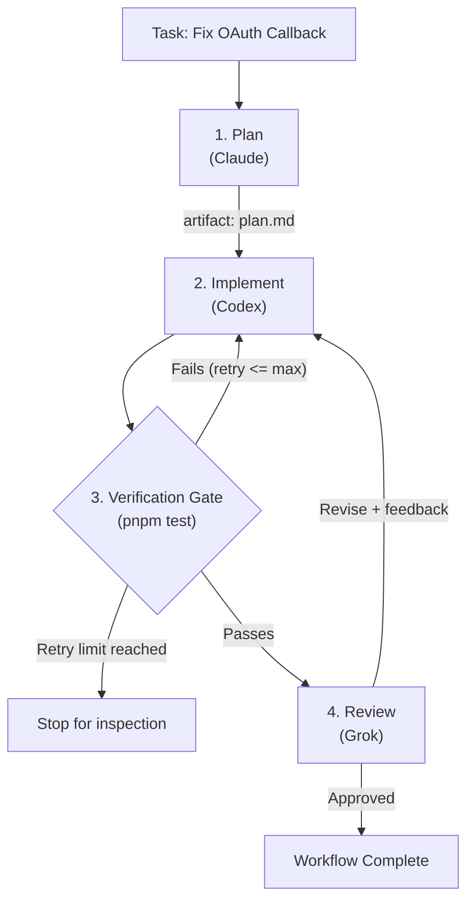

# Migent

<p align="center">
  <br>
  <strong>Autonomous, multi-stage engineering pipelines for your coding agents.</strong><br>
  Repeatable workflows. Multi-agent orchestration. Native CLI execution. Full observability.
</p>

<p align="center">
  <a href="https://www.npmjs.com/package/@nodeint/migent"></a>
  <a href="https://github.com/nodeint/migent/blob/main/LICENSE"></a>
  <a href="https://nodejs.org"></a>
  
</p>

---

Migent coordinates the coding-agent CLIs you already have into **reusable, verified engineering pipelines**. Instead of juggling tabs, manually copying plans, and pasting test errors back and forth, you define the pipeline as code. Migent orchestrates the handoffs, runs strict local verification gates, handles review loops, and captures deep execution metrics.

### 🌟 Why Migent?

- 🔁 **Automate Recurring Tasks (Workflows & Stages):** Package routine engineering work—bug fixes, refactors, migrations, test authoring—into structured, multi-stage pipelines with deterministic verification gates.
- 🤖 **Multi-Agent Orchestration & Flexibility:** Assign the best model to each role (`claude` for planning, `codex` for implementation, `grok` for independent review). Run directly through your installed agent CLIs without custom wrappers or API lock-in.
- 📊 **Observability & Continuous Improvement:** Live-stream running pipelines with `session follow`, and collect token spend, wall-time, and revision counts with `session metrics` to measure and refine your team's workflows.

---

## Quickstart

### Option A: Agent-Assisted via `/migent` (Recommended)

Let your coding agent handle the initial configuration using Migent's official Skill.

```bash
# 1. Install Migent globally
npm install -g @nodeint/migent

# 2. Install the Migent Skill in your repo
migent skill install
```

Now open your favorite coding agent CLI (such as Google Antigravity `agy`, Anthropic `claude`, Cursor, or Windsurf) in this repository and type:

```text
/migent Set up a workflow for this repo: Claude for planning, Codex for coding, Grok for review. Then run a pipeline to resolve issue #42.
```

> **How it works:** `migent skill install` creates `.agents/skills/migent/` containing Migent's schema rules and CLI definitions. Using the `/migent` slash command instructs your agent to inspect your repo, generate valid configuration files under `.migent/`, validate them with `migent doctor`, and launch the workflow.

---

### Option B: Terminal CLI (Direct Control)

Prefer setting it up yourself? Get started in three commands:

```bash
# 1. Initialize a workflow preset and validate environment
migent init --preset plan
migent doctor

# 2. Run your engineering task
migent session run --workflow plan --task "Implement JWT authentication with refresh tokens"

# 3. Stream real-time events or inspect performance metrics
migent session follow <session-id>
migent session metrics <session-id> --json
```

---

## What Migent Solves

| Without Migent | With Migent |
| :--- | :--- |
| **Manual handoffs:** Copying plans and pasting stack traces across conversations. | **Automated handoffs:** Upstream artifacts and diffs pass automatically into downstream stages. |
| **Single-agent bottleneck:** One model handles planning, coding, and review, accumulating context bloat. | **Specialized roles:** Multi-agent pipeline with dedicated models per role (e.g., Planner $\rightarrow$ Coder $\rightarrow$ Reviewer). |
| **Vendor lock-in & wrappers:** Restricted to one provider or requiring custom API adapters. | **Native CLI execution:** Drives your installed agent CLIs (`agy`, `claude`, `codex`, `grok`, `opencode`) directly in your workspace. |
| **Blind trust:** Agents claim "all tests pass" without actually running project commands. | **Verification gates:** Real local checks (`pnpm test`, `pytest`, `cargo test`) must succeed before advancing. |
| **Fragile one-off prompts:** Team members execute tasks with inconsistent, ad-hoc instructions. | **Process as code:** Workflows live in Git (`.migent/workflows/`), making best practices versioned and repeatable. |
| **No execution visibility:** No record of how long tasks took, why checks failed, or how many retries occurred. | **Telemetry & Metrics:** Append-only event logs, live streaming, and full JSON metrics for duration, retries, and token cost. |

---

## How It Works

A typical software engineering workflow breaks down into structured, verifiable stages:



1. **Plan:** A high-reasoning model analyzes the codebase and generates an actionable `plan.md`.
2. **Implement:** A coding model applies changes to the working tree according to the plan.
3. **Verify Gate:** Migent runs your repository's native verification commands (tests, typecheck, lint).
4. **Review & Revision Loop:** An independent reviewer evaluates the git diff against the plan. If changes are requested, feedback routes back to the implementation stage.

---

## Core Capabilities

### 1. Repeatable Workflows as Code
Define stages, dependencies, artifacts, and routing decisions in declarative YAML stored under `.migent/workflows/`. Version control your engineering processes alongside your application code.

### 2. Multi-Agent Orchestration & BYO CLIs
Decouple **what** a stage does from **which model** executes it. Migent drives the agent CLIs already installed and authenticated on your machine:

| Provider | CLI | Typical Role in Pipeline |
| :--- | :--- | :--- |
| **Anthropic Claude** | `claude` | High-reasoning architecture planning & refactoring |
| **Google Antigravity** | `agy` | Deep repository analysis, plan generation & review |
| **OpenAI Codex** | `codex` | Fast, focused implementation & unit test authoring |
| **xAI Grok** | `grok` | Independent logic review & edge case discovery |
| **OpenCode** | `opencode` | Headless JSON runs via `opencode run` |

Switch models anytime in `.migent/config.yaml` without touching your workflow logic.

### 3. Observability, Telemetry & Continuous Improvement
Migent treats engineering runs as first-class observable processes:
- **Live Monitoring:** `migent session follow <session-id>` streams execution events, stage heartbeats, and runner turns in real time.
- **Detailed Metrics:** `migent session metrics <session-id> --json` outputs execution wall-time, active runner seconds, verify durations, revision counts, and token usage.
- **Continuous Refinement:** Use hard metrics from past sessions to optimize prompts, tune retry limits, and pick the most cost-effective models.
- **Session Recovery:** When rate limits or network issues strike, `migent session continue <session-id>` resumes right where the pipeline stopped.

---

## Configuration Example

Migent separates model/role assignments from pipeline control flow.

### 1. Configure Models and Roles (`.migent/config.yaml`)

```yaml
schema_version: 2

models:
  planning-model:
    provider: claude
    model: opus

  coding-model:
    provider: codex
    model: default

  review-model:
    provider: grok
    model: grok-4.7

roles:
  planner:
    default_model: planning-model
    instructions:
      - Analyze the repository and create an actionable plan with file paths.

  coder:
    default_model: coding-model
    instructions:
      - Implement changes according to the plan and write regression tests.

  reviewer:
    default_model: review-model
    instructions:
      - Review the git diff against the plan for correctness, security, and edge cases.
```

### 2. Define the Pipeline (`.migent/workflows/feature.yaml`)

```yaml
schema_version: 2
id: feature

stages:
  - id: plan
    role: planner
    produces:
      artifact: plan.md

  - id: implement
    role: coder
    depends_on: [plan]
    verify:
      - pnpm test
    max_verify: 3

  - id: review
    role: reviewer
    depends_on: [implement]
    decision:
      values: [approved, revise]
      routes:
        approved: complete
        revise: implement

outputs:
  - name: plan
    from_stage: plan
    artifact: plan.md
```

---

## CLI Cheatsheet

```bash
# Setup & Health
migent init --preset plan           # Initialize starter configuration
migent doctor                      # Validate configuration, schemas, and CLI availability
migent provider list               # List registered provider adapters and their available models
migent skill install               # Install the Migent Skill for coding agents (.agents/skills/migent/)

# Execution
migent session run --workflow <id> --task "<task>"   # Run a workflow
migent session continue <session-id>                 # Resume an interrupted or blocked session

# Monitoring & Telemetry
migent session list                                  # List recorded sessions and statuses
migent session follow <session-id>                   # Live-stream session events and progress
migent session metrics <session-id> --json           # View token spend, duration, and retry metrics
migent session show <session-id>                     # Inspect session state and artifact status
```

---

## Documentation

- [Writing Workflows](https://github.com/nodeint/migent/blob/main/docs/workflows.md) — Stages, dependencies, artifacts, and routing decisions.
- [Providers and Model Configuration](https://github.com/nodeint/migent/blob/main/docs/providers.md) — Configuring CLIs, models, options, and fallback models.
- [Sessions and State](https://github.com/nodeint/migent/blob/main/docs/sessions.md) — Manifests, append-only event logs, and recovery.
- [CLI Reference](https://github.com/nodeint/migent/blob/main/docs/cli.md) — Full command catalog, flags, and JSON modes.

## Contributing

Migent is built with TypeScript in a pnpm workspace:

```bash
pnpm install
pnpm build
pnpm test
```

See [CONTRIBUTING.md](https://github.com/nodeint/migent/blob/main/CONTRIBUTING.md) for details.

## License

Migent is open source under the [MIT License](https://github.com/nodeint/migent/blob/main/LICENSE).
