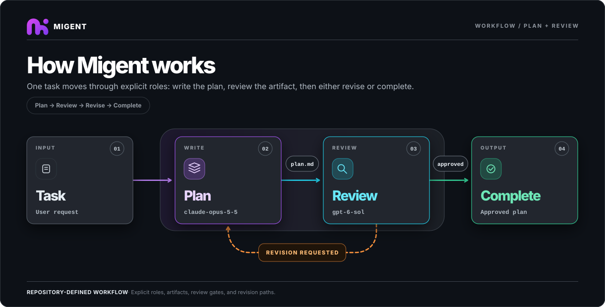

<p align="center">
  <br>
    <strong>Compose AI coding agents into repeatable engineering workflows.</strong>
</p>

<p align="center">
  <a href="https://www.npmjs.com/package/@nodeint/migent"></a>
</p>

---

Migent connects coding-agent CLIs across models and vendors through explicit,
repository-defined workflows. One model can plan, another can review, and the
first can revise—while Migent passes artifacts between them and tracks
the workflow's progress.


<p align="center">
  
</p>


## Contents

- [Contents](#contents)
- [What you can do](#what-you-can-do)
- [Why Migent?](#why-migent)
- [Supported CLIs](#supported-clis)
- [Editor extension](#editor-extension)
- [Quickstart](#quickstart)
  - [Install Migent](#install-migent)
  - [Option 1: Set up with an AI agent](#option-1-set-up-with-an-ai-agent)
  - [Option 2: Set up manually](#option-2-set-up-manually)
  - [Project files](#project-files)
  - [Tracking](#tracking)
- [Workflow as code](#workflow-as-code)
  - [Start with one role and one stage](#start-with-one-role-and-one-stage)
  - [Add planning and review](#add-planning-and-review)
  - [Beyond sequential workflows](#beyond-sequential-workflows)
- [Concepts](#concepts)
- [Roadmap](#roadmap)
  - [In progress](#in-progress)
  - [Planned](#planned)
- [Update Migent](#update-migent)
- [Documentation](#documentation)
- [License](#license)

## What you can do

- **Define roles, choose models.** Define each role's responsibilities and assign a client and model suited to its work.
- **Run a single role.** Ask a planner, developer, or reviewer to work on a task, then continue the conversation in the same session.
- **Automate workflows.** Connect roles with artifact handoffs, verification checks, and review cycles.
- **Keep people involved.** Let agents ask questions and continue with your answers.
- **Track and resume work.** Inspect sessions, follow live activity, and continue stopped work.
- **Connect workflows.** Start a new workflow using a completed session's outputs as context.
- **Inspect usage.** View session time, token usage, reported costs, and revision counts.
- **Work from your editor or agent.** Use the editor extension or let an AI agent operate Migent through its skill.

## Why Migent?

Different models bring different strengths, often across different vendors
and coding-agent CLIs. Using them together means coordinating the work yourself.

- **You become the bridge.** Copy plans between conversations, carry review
  feedback back to the author, and keep each model working from the latest context.
- **You keep track of progress.** Remember what was approved, what needs revision,
  and where to pick up when work stops.
- **You repeat the coordination.** Recreate the same handoffs and review steps
  for the next task or teammate.

Migent turns that coordination into a repeatable process:

- **Assign roles, choose models.** Run a role independently or connect several
  into a workflow. Change clients without rewriting the process.
- **Make handoffs explicit.** Pass artifacts between stages, verify results,
  and route review feedback back for revision.
- **Keep progress and process.** Inspect and resume saved sessions; version
  roles and workflows alongside your code.

Each client CLI keeps its own authentication, tools, and execution capabilities.

## Supported CLIs

Install and sign in to the CLIs you use with Migent:

- [`agy`](https://github.com/google-antigravity/antigravity-cli)
- [`claude`](https://code.claude.com/docs/en/overview)
- [`codex`](https://developers.openai.com/codex/cli)
- [`grok`](https://docs.x.ai/build/overview)
- [`opencode`](https://opencode.ai/)

## Editor extension

Use Migent from your editor with the **Migent extension**:

- [Install for VS Code](https://marketplace.visualstudio.com/items?itemName=nodeint.migent-vscode)
- [Install for Cursor and other Open VSX editors](https://open-vsx.org/extension/nodeint/migent-vscode)

## Quickstart

Before you begin, make sure you have:

- Node.js 22+ installed.
- The [client CLIs](#supported-clis) you plan to use. Install them and sign in.

### Install Migent

```bash
# Install Migent globally
npm install -g @nodeint/migent@latest

# Verify that Migent is installed
migent --version

# Install the agent skill
migent skill install
```

Then run setup from your project root, either with an AI agent or with the CLI.

### Option 1: Set up with an AI agent

1. Paste this prompt into your agent:

   ```text
   Use the migent skill to set up Migent in this project.
   ```

   The agent handles setup. If you have specific client or model
   preferences, mention them for each role in the same prompt.

2. Ask the agent to run a single role, such as the reviewer (optional):

   ```text
   Use the migent skill to ask the reviewer role to review my latest changes.
   ```

3. Ask the agent to write and review a plan for your task (optional):

   ```text
   Use the migent skill to run the plan workflow for this task: <Describe your task here>.
   ```

4. Ask the agent to implement the plan and review the changes (optional):

   ```text
   Use the migent skill to run the implement workflow with this plan: <Path to your plan file>.
   ```

### Option 2: Set up manually

1. Run `migent init` and choose the client, model, and options for the
   developer and reviewer:

   ```bash
   migent init
   ```

2. Run a single role, such as the reviewer (optional):

   ```bash
   migent session run --role reviewer --prompt "Review my latest changes"
   ```

3. Write and review a plan for your task (optional):

   ```bash
   migent session run --workflow plan --task "<Describe your task here>"
   ```

4. Implement the plan and review the changes (optional):

   ```bash
   migent session run --workflow implement --task "<Path to your plan file>"
   ```

### Project files

After setup, your project contains:

```text
.migent/
├── config.yaml        # agents and the architect, reviewer, developer, operator roles
├── config.local.yaml  # local configuration overrides
├── .gitignore         # keeps run history and local overrides out of Git
└── workflows/
    ├── implement.yaml # implement and review a task
    └── plan.yaml      # write and review a plan
```

Commit these files to share the setup. Run history is saved in
`.migent/sessions/` when you start a task. The skill lives in your chosen AI client's skills directory.

### Tracking

Migent shows progress as it runs. A successful run ends with `completed`;
workflows that publish files also print their paths.

Each run is a session. Open another terminal in the project root to find
active sessions and inspect one:

```bash
migent session list --status active
migent session show <session-id>
```

The `show` command prints the current status, running stages, latest decisions, blockers,
and published outputs. To watch live stage events and client activity, run:

```bash
migent session follow <session-id> --exit-when-done
```

The watcher exits when the session completes, becomes blocked, or is cancelled.
Press Ctrl+C to stop watching; the workflow keeps running in its own terminal.
Use `migent session list` to include stopped sessions, then resume one with:

```bash
migent session continue <session-id>
```

Session files are saved under `.migent/sessions/`. A typical workflow session
contains:

```text
.migent/sessions/<session-id>/
├── manifest.yaml              # session identity and workflow
├── workflow.frozen.yaml       # workflow and role settings used by this run
├── task.md                    # original task
├── status.json                # current status, stages, and decisions
├── events.jsonl               # session event history
├── outputs/                   # published workflow results, when available
└── executions/
    └── <order>-<stage-id>--attempt-<n>/
        ├── execution.json     # stage attempt status and metadata
        ├── stream.jsonl       # client activity and heartbeats
        ├── prompt.md          # prompt sent to the agent
        ├── response.md        # model response only, when the model produced one
        ├── failure.md         # readable failure report, when the execution failed
        └── artifacts/         # files produced by this stage
```

Read `response.md` for what the model said and `failure.md` for why an attempt
failed. Read artifacts to inspect the work behind each stage. Use the
CLI to manage session state. See [Sessions](docs/sessions.md) for the full
layout and recovery commands.

## Workflow as code

Workflows live in `.migent/workflows/`. Roles live in `.migent/config.yaml`.
A role defines responsibilities and selects an agent: a model, an effort, and
the CLI client that runs it. A stage assigns work to a role; a
workflow connects those stages.
Role responsibilities set shared working standards; stage instructions define the task.

### Start with one role and one stage

The following examples show how to write custom workflows. `migent init`
generates the workflows described in the quickstart.

Set the role's client and model in its `agent`. Use model IDs available
from `migent get models` in place of the example IDs.

```yaml
# .migent/config.yaml
schema_version: 7
roles:
  developer:
    description: Implements the change and verifies it.
    responsibilities:
      - Make focused changes that address root causes and follow project conventions.
      - Preserve unrelated behavior and support changes with relevant checks.
    agent:
      model: sonnet
```

This workflow asks the developer to implement a task, then checks the result:

```yaml
# .migent/workflows/implement.yaml
schema_version: 7
stages:
  - id: implement
    role: developer
    instructions:
      - Implement the requested behavior, including edge cases and relevant tests.
      - Address required review findings when revising and rerun affected checks.
    verify:
      - pnpm build
      - pnpm test
```

Replace the `verify` commands with your project's build and test commands.
Run the workflow with `migent session run`, as in the quickstart:

```bash
migent session run --workflow implement --task "Add a --json flag to the export command"
```

If verification fails, Migent asks the agent to fix the problem and checks again.

To change the developer's client or model, edit its `agent`. The
workflow still refers to `developer`. After editing configuration or workflows,
run `migent doctor` to check them.

### Add planning and review

For a plan-and-review workflow, define two roles. They can use the same model
or different clients:

```yaml
# .migent/config.yaml
schema_version: 7
roles:
  planner:
    description: Designs the approach and writes the plan.
    responsibilities:
      - Design maintainable architecture grounded in repository evidence.
      - Keep designs proportional to the task; produce plans without changing code.
    agent:
      model: opus
      effort: high
  reviewer:
    description: Reviews plans and implementations against the task.
    responsibilities:
      - Assess correctness, completeness, and maintainability using concrete evidence.
      - Report substantive findings with impact and required corrections; do not edit code.
    agent:
      model: gpt-6.1-sol
      effort: medium
```

The planner produces `plan.md`. The reviewer receives it through `depends_on`
and decides whether to approve it or send it back for revision:

```yaml
# .migent/workflows/plan.yaml
schema_version: 7
artifacts:
  approved_plan:
    file: plan.md
stages:
  - id: plan
    role: planner
    ask: human
    max_revisions: 3
    instructions:
      - Define scope, component boundaries, contracts, and key trade-offs in plan.md.
      - Ask the user when scope or requirements are unclear.
      - Resolve substantive review findings when revising the plan.
    artifacts: [approved_plan]

  - id: review_plan
    role: reviewer
    depends_on: [plan]
    instructions:
      - Review plan.md against the task and codebase for feasibility and architectural gaps.
      - Report required corrections together; keep the review at the architecture level.
    decision:
      - approved:
          when: The plan meets the task with no substantive architectural gaps.
          navigate: complete
      - revise:
          when: Scope, feasibility, or architectural issues require corrections.
          navigate: plan
```

Run this workflow with:

```bash
migent session run --workflow plan --task "Plan a --json flag for the export command"
```

`max_revisions` limits the number of revisions. The file declared in `produces`
is an **artifact**; 

`depends_on` makes it available to the reviewer. The
**decision** selects a route: `approved` completes the workflow, while `revise`
returns to `plan` with the review feedback.

`ask: human` lets the planner pause for your answers and continue the same
conversation. `outputs` publishes the final plan when the workflow completes.

### Beyond sequential workflows

- **Branch and join.** Use `concurrency` to run independent stages in parallel,
  `navigate: [test, docs]` to branch, and `depends_on` to wait for upstream stages.
- **Run only relevant work.** Use `run_when.changed_paths` to run a stage only
  when matching Git paths have changed.
- **Tune each stage.** Share named agents across roles, set model `effort`, or
  override a stage's `model` and client `options` with an inline agent.
- **Control context.** Set shared `constraints` for the workflow or use
  `session.resume_from` to continue an upstream stage's client conversation.
- **Set check limits.** Use `max_verify` and `verify_timeout` to bound checks;
  omit `role` for a stage that only runs verification commands.
- **Connect workflows.** Declare `downstream` suggestions that pass published
  outputs to a new workflow when you start it with `--prior`.

See [Writing workflows](docs/workflows.md) and
[Agent configuration](docs/agents.md) for details and examples.

## Concepts

- **Workflow:** A process made of stages, such as plan, review, and implement.
- **Stage:** One step with instructions for a role, optional checks, and a next step.
- **Role:** A kind of work, such as developer or reviewer, with a default client and model.
- **Model:** The AI model a role uses, identified by its model ID and client.
- **Artifact:** A file a stage produces for later stages or the user, such as `plan.md`.
- **Decision:** A stage's choice of what happens next, such as `approved` or `revise`.
- **Session:** A saved run of a workflow or role that you can inspect and continue.

## Roadmap

### In progress

- [ ] **Everyday CLI** — Refine core commands for reliable daily use.
- [ ] **IDE extensions** — Simplify interactions and visualize Migent inside your editor.

### Planned

- [ ] **Local app** — Manage Migent workspaces across your machine in one place.
- [ ] **Operations chatbot** — Configure, run, and monitor Migent through conversation.
- [ ] **Team collaboration** — Support shared workflows and coordination across teams.

## Update Migent

```bash
migent get workflows   # inspect configured workflows
migent update          # upgrade the CLI (add --check to only look)
migent doctor          # check config, workflows, and client CLIs
migent migrate         # upgrade config and workflows to the current schema
migent skill update    # refresh installed skill copies
```

## Documentation

See the [documentation map](docs/README.md) to find guides by topic, task, and search term.

Run `migent <command> --help` for command options. To contribute to Migent, see
[CONTRIBUTING.md](CONTRIBUTING.md).

## License

Migent is licensed under the [MIT License](https://github.com/nodeint/migent/blob/main/LICENSE).
