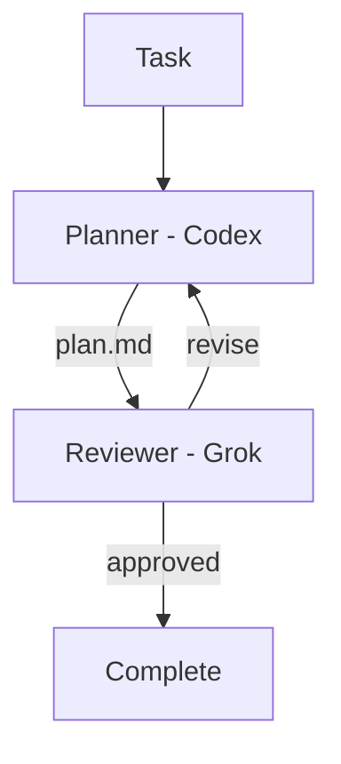

# Migent

<p align="center">
  <br>
  <strong>Compose AI coding agents into repeatable engineering workflows.
</strong>
</p>

<p align="center">
  <a href="https://www.npmjs.com/package/@nodeint/migent"></a>
  <a href="https://github.com/nodeint/migent/blob/main/LICENSE"></a>
  <a href="https://nodejs.org"></a>
</p>

---


Migent connects coding-agent CLIs from different providers through explicit,
repository-defined workflows. One model can plan, another can review, and the
first can revise—while Migent carries artifacts between them and remembers
where the process is.

## Contents

- [Migent](#migent)
  - [Contents](#contents)
  - [Why Migent?](#why-migent)
  - [Supported CLIs](#supported-clis)
  - [Quickstart](#quickstart)
    - [Install](#install)
    - [Install agent skill](#install-agent-skill)
    - [Create a project](#create-a-project)
      - [Option 1: Ask your AI agent](#option-1-ask-your-ai-agent)
      - [Option 2: Run `migent init`](#option-2-run-migent-init)
    - [Run](#run)
  - [Workflow as code](#workflow-as-code)
    - [How decisions work](#how-decisions-work)
    - [Beyond planning: code and verify](#beyond-planning-code-and-verify)
  - [Concepts](#concepts)
    - [Artifact handoff vs session resume](#artifact-handoff-vs-session-resume)
    - [Built-in safeguards](#built-in-safeguards)
  - [Current scope](#current-scope)
  - [Documentation](#documentation)
  - [Development](#development)
  - [License](#license)

## Why Migent?

Calling two agent CLIs from a shell script is easy. Reliably coordinating them
across reviews, revisions, failures, and resumed sessions is not.

Migent is built around three ideas:

- **Use models for what they do best.** Assign each role to a provider and model
  suited to the work, rather than asking one agent to do everything.
- **Treat AI engineering process as code.** Keep stages, handoffs, review gates,
  and revision policies in version control beside the project they govern.
- **Keep orchestration explicit.** The team defines the process; models execute
  roles inside it. A supervisor model does not invent or dynamically control
  the workflow.

**Models describe execution. Roles describe intent.** Changing the model behind
a role does not require rewriting the workflow.

**Common workflow model, native provider capabilities.** Migent coordinates
the process, while each provider CLI remains responsible for authentication,
agent execution, and its own tools and options.



## Supported CLIs

Migent drives each provider through its headless CLI. Install and sign in to the
ones your configuration names.

| Provider           | CLI          |
| -------------------| -------------|
| Google Antigravity | `agy`        |
| Claude             | `claude`     |
| Codex              | `codex`      |
| Grok               | `grok`       |
| BytePlus           | `opencode`   |
| OpenCode           | `opencode`   |

## Quickstart

Requires Node.js 22+ (macOS, Linux, or Windows) and the provider CLIs you plan
to use, installed and signed in. `migent doctor` reports any that are missing.

Install Migent first:

```bash
npm install -g @nodeint/migent
migent --version
```

Upgrade with `npm install -g @nodeint/migent@latest`.

There are two ways to set up a project. Both end with the same files and the
same next command.

### With an AI agent

1. Install the agent skill. It uses `npx skills`, so it needs Node 22.20 or
   newer. Pick a project or global install and the AI clients to set up:

   ```bash
   migent skill install
   ```

2. Paste this prompt into your agent (Claude Code, Codex, Antigravity, Cursor,
   etc.):

   ```text
   Use the migent skill to set up Migent in this project.
   ```

The agent checks which provider CLIs are available (`migent provider list`) and
runs `migent init --no-input` with a provider and model it picked. Ask it for a
specific provider, model, or the `plan` preset if you have a preference. Run
`migent skill update` after upgrading Migent. See
[docs/cli.md](docs/cli.md#project-skill) for options.

### Manually

```bash
migent init
```

`init` asks for a provider and model, from the provider CLIs it finds on your
machine, and for the `implement` or `plan` workflow. It also offers to install
the agent skill. To skip the prompts, pass everything as flags:

```bash
migent init --provider codex --model gpt-5 --preset implement --no-input
```

`init` runs `migent doctor` when it finishes and prints any problem it finds,
such as a provider CLI that is not on your PATH. It does not start a model. It
ends by printing the command to run next.

### What you get

Either way, `init` generates:

```text
.migent/
├── config.yaml        # roles and model aliases, committed
├── config.local.yaml  # this machine's provider and model, not committed
├── .gitignore         # keeps sessions/ and config.local.yaml untracked
└── workflows/
    └── implement.yaml # or plan.yaml with --preset plan
```

`config.yaml` names the roles and stable model aliases (for example
`code_generation`). `config.local.yaml` maps each alias to the provider and
model on this machine. Commit `config.yaml` and `workflows/`. With the `plan`
preset, the planner and reviewer both start on the model you chose; point either
alias at another model by editing `config.local.yaml`.

`migent config` prints the effective config. No command edits it: change
`config.yaml` or `config.local.yaml` directly, or ask your agent to, then run
`migent doctor`.

### Run

Start the workflow from your project directory. Replace the task text:

```bash
migent session run --workflow implement --task "Add a --json flag to the export command"
```

Progress prints on stderr. A completed run lists the files it published:

```text
session_id: 5f0c2b6e-8d1a-4c52-9a0e-3b7d41c9e2aa
stage implement · attempt 1 · 10:15:30 · codex/gpt-5 (effort: medium).
stage implement · attempt 1 · 2m 15s · complete.
completed · 2m 15s
```

Inspect sessions or resume a stopped run:

```bash
migent session list
migent session continue <session-id>
```

### Join an existing project

`.migent/config.local.yaml` is not committed, so every clone needs its own.

1. Install and sign in to the provider CLIs you plan to use.
2. Run `migent provider list` to see available providers and model IDs.
3. Run `migent doctor`. For each alias with no mapping on this machine, it
   prints the YAML to add. Put it in `.migent/config.local.yaml`, for example:

   ```yaml
   models:
     code_generation:
       provider: codex
       model: gpt-5
   ```

4. Run `migent doctor` again, then start a workflow as above.

An agent with the skill installed can do steps 2 to 4 for you. If a project
commits complete provider and model mappings in `config.yaml`, the local file is
optional and only needs machine-specific overrides.

## Workflow as code

Workflows live in `.migent/workflows/`. Roles and model aliases live in `.migent/config.yaml`; the provider and model behind each alias live in `.migent/config.local.yaml`.

A standard plan-and-review workflow:

```yaml
# .migent/workflows/plan.yaml
schema_version: 2
stages:
  - id: plan
    role: planner
    max_revisions: 3
    instructions:
      - Read task.md and write plan.md into artifacts.
    produces:
      artifact: plan.md

  - id: review_plan
    role: reviewer
    depends_on: [plan]
    instructions:
      - Verify plan.md against the codebase.
      - Approve only if implementation can proceed without ambiguity.
    decision:
      values: [approved, revise]
      routes:
        approved: complete
        revise: plan
```

The roles use model aliases named for the work they do:

```yaml
# .migent/config.yaml (committed)
schema_version: 2
models:
  deep_reasoning: {}
  critical_review: {}

roles:
  planner:
    default_model: deep_reasoning
  reviewer:
    default_model: critical_review
```

Each machine maps the aliases to the provider CLIs it has:

```yaml
# .migent/config.local.yaml (this machine, not committed)
models:
  deep_reasoning:
    provider: codex
    model: gpt-5
  critical_review:
    provider: grok
    model: grok-4
    options:
      reasoning-effort: high
```

### How decisions work

Migent enforces a clean, lightweight protocol. Stages communicate outcomes
through standard RFC-style response headers injected into the prompt:

```text
status: complete
decision: approved

The implementation plan covers all requirements and test cases.
```

When a stage completes, Migent routes execution based on the `decision` header.
Review prose remains human-readable feedback passed directly to the next stage.

### Beyond planning: code and verify

Stages are not limited to generating documents. A stage can modify repository files
and declare automated `verify` commands:

```yaml
stages:
  - id: implement
    role: developer
    instructions:
      - Implement the approved plan.
    verify:
      - pnpm build
      - pnpm test
    max_verify: 3
```

Migent runs the verification commands in the workspace POSIX shell. If tests fail,
Migent returns the command tail to the agent for an automated repair loop (up to
`max_verify` attempts) before handing off to review.

## Concepts

A workflow connects stages through dependencies and explicit decision routes.

- A **model** identifies a provider model and its execution options.
- A **role** names a kind of work and selects its default model.
- A **stage** assigns work to a role and may declare dependencies, an artifact,
  a decision, or verification commands.
- An **artifact** is a named file produced by a successful stage and stored with
  the workflow session.
- A **decision** selects the next route, including a route back for revision.
- A **session** records executions, events, decisions, and artifacts so work can
  be inspected or resumed.

### Artifact handoff vs session resume

- `depends_on: [stage]`: Makes the upstream stage's artifacts available to the
  current stage while starting a fresh provider agent. Best for clean context
  handoffs between different roles and models.
- `session.resume_from: <stage>`: Continues the upstream stage's provider conversation
  thread. Best when an agent needs to keep its conversation memory and tool history.

### Built-in safeguards

Engineering workflows have explicit cost and execution guardrails:

- **Revision limits (`max_revisions`)**: Prevents infinite critique loops between
  agents.
- **Dispatch circuit breaker (`--max-dispatches`)**: Halts execution if a run
  exceeds the configured dispatch limit (default 20).
- **Verification bounds (`max_verify`, `verify_timeout`)**: Limits automated
  test/repair attempts.
- **Session metrics (`metrics.json`)**: Tracks tokens, turns, and cost per execution
  and session.

## Current scope

Migent is a local, file-backed orchestration layer for provider CLIs. It does
not replace their agent runtimes, and it does not hide their distinctive
capabilities behind a lowest-common-denominator API.

Today, Migent supports explicit stage routing, review loops, local session
history, provider-session resume, prerequisite workflows, and standalone role
execution. A machine-local registry service records workspaces
so another tool can ask which projects exist.

Workflows can be run directly from the command line, or driven autonomously by your
coding agent when the project has the Migent skill installed.

## Documentation

- [Writing workflows](https://github.com/nodeint/migent/blob/main/docs/workflows.md)
- [Providers and model configuration](https://github.com/nodeint/migent/blob/main/docs/providers.md)
- [Sessions and workflow composition](https://github.com/nodeint/migent/blob/main/docs/sessions.md)
- [CLI commands and execution controls](https://github.com/nodeint/migent/blob/main/docs/cli.md)

Run `migent <command> --help` for the exact command contract, output fields,
and exit codes.

## Development

The pnpm workspace contains four packages: the `@nodeint/migent` CLI and its
internal libraries `@nodeint/migent-kernel`, `@nodeint/migent-adapters`, and
`@nodeint/migent-registry`. The libraries have no stable API; depend on
`@nodeint/migent`.

```bash
pnpm install
pnpm build
pnpm test
pnpm migent --help   # run the local build
```

See [CONTRIBUTING.md](CONTRIBUTING.md) for testing rules, platform notes, and
the release process.

## License

Migent is licensed under the [MIT License](https://github.com/nodeint/migent/blob/main/LICENSE).