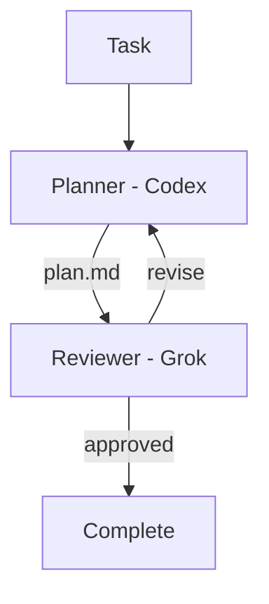

# Migent

**Compose AI coding agents into repeatable engineering workflows.**

Use the right model for each stage of the job.

Migent connects coding-agent CLIs from different providers through explicit,
repository-defined workflows. One model can plan, another can review, and the
first can revise—while Migent carries artifacts between them and remembers
where the process is.

## Contents

- [Migent](#migent)
  - [Contents](#contents)
  - [Why Migent?](#why-migent)
  - [Supported CLIs](#supported-clis)
  - [Quickstart](#quickstart)
    - [Install](#install)
    - [Create a project](#create-a-project)
    - [Run](#run)
    - [Next](#next)
  - [Concepts](#concepts)
  - [Current scope](#current-scope)
  - [Documentation](#documentation)
  - [Development](#development)
  - [License](#license)

## Why Migent?

Calling two agent CLIs from a shell script is easy. Reliably coordinating them
across reviews, revisions, failures, and resumed sessions is not.

Migent is built around three ideas:

- **Use models for what they do best.** Assign each role to a provider and model
  suited to the work, rather than asking one agent to do everything.
- **Treat AI engineering process as code.** Keep stages, handoffs, review gates,
  and revision policies in version control beside the project they govern.
- **Keep orchestration explicit.** The team defines the process; models execute
  roles inside it. A supervisor model does not invent or dynamically control
  the workflow.

**Models describe execution. Roles describe intent.** Changing the model behind
a role does not require rewriting the workflow.

**Common workflow model, native provider capabilities.** Migent coordinates
the process, while each provider CLI remains responsible for authentication,
agent execution, and its own tools and options.



## Supported CLIs

Migent drives each provider through its headless CLI. Install and sign in to the
ones your configuration names.

| Provider           | CLI      |
| -------------------| -------- |
| Google Antigravity | `agy`    |
| Claude             | `claude` |
| Codex              | `codex`  |
| Grok               | `grok`   |

## Quickstart

Requires Node.js 22+ (macOS, Linux, or Windows) and the provider CLIs your
config uses, already signed in.

### Install

```bash
npm install -g @nodeint/migent
migent --version
```

Upgrade with `npm install -g @nodeint/migent@latest`.

### Create a project

From the repository where agents will work:

```bash
migent init
```

In a terminal, `init` walks you through the provider, model, and options, then
offers to install the Migent skill so agents in the project know how to run it.
Without a terminal, pass `--provider` and `--model` together. Pass `--skill` to
install the skill without the prompt.

It creates:

```text
.migent/
├── config.yaml        # models and roles
├── .gitignore         # keeps sessions/ untracked
└── workflows/
    └── plan.yaml      # plan-and-review workflow

.agents/skills/migent/ # only if you install the skill
```

Commit `config.yaml` and `workflows/`. To add the skill later, run
`migent skill install`.

### Run

From the project or any subdirectory:

```bash
migent session run --workflow plan --task "Plan the account settings redesign"
```

`--task` is one line and is stored in the session as `task.md`. For a longer
task, create the session first, write the file, then start it:

```bash
migent session prepare wave-3 --workflow plan
migent session run --session wave-3 --workflow plan
```

Migent runs each eligible stage until the workflow completes or stops. Omit
`--workflow` and pass `--role` to run one role instead. A workflow run prints
one JSON result with the session id, status, stop reason, decision, and output
paths. A role run prints a table unless `--json`. Stderr prints one line when
a stage starts and one when it finishes. If the session stops before it is
completed, stderr ends with `migent session continue <session-id>`. The same
command resumes a role session. Then inspect or resume:

```bash
migent session list
migent session list --latest --json
migent session follow <session-id>
migent session continue <session-id>
```

`session list --json` and a JSON snapshot omit the task text.

### Next

- [Providers and model configuration](https://github.com/nodeint/migent/blob/main/docs/providers.md)
- [Writing workflows](https://github.com/nodeint/migent/blob/main/docs/workflows.md#complete-example)
- [CLI commands and exit codes](https://github.com/nodeint/migent/blob/main/docs/cli.md)
- [Sessions and workflow composition](https://github.com/nodeint/migent/blob/main/docs/sessions.md)

## Concepts

A workflow connects stages through dependencies and explicit decision routes.

- A **model** identifies a provider model and its execution options.
- A **role** names a kind of work and selects its default model.
- A **stage** assigns work to a role and may declare dependencies, an artifact,
  a decision, or both.
- An **artifact** is a named file produced by a successful stage and stored with
  the workflow session.
- A **decision** selects the next route, including a route back for revision.
- A **session** records executions, events, decisions, and artifacts so work can
  be inspected or resumed.

Use `depends_on` to give a stage upstream artifacts. Every visit of a stage
continues that stage's provider agent. Use `session.resume_from` when a stage
must continue a different stage's provider session.

## Current scope

Migent is a local, file-backed orchestration layer for provider CLIs. It does
not replace their agent runtimes, and it does not hide their distinctive
capabilities behind a lowest-common-denominator API.

Today, Migent supports explicit stage routing, review loops, local session
history, provider-session resume, prerequisite workflows, and standalone role
execution. A machine-local registry service records workspaces
so another tool can ask which projects exist.

## Documentation

- [Writing workflows](https://github.com/nodeint/migent/blob/main/docs/workflows.md)
- [Providers and model configuration](https://github.com/nodeint/migent/blob/main/docs/providers.md)
- [Sessions and workflow composition](https://github.com/nodeint/migent/blob/main/docs/sessions.md)
- [CLI commands and execution controls](https://github.com/nodeint/migent/blob/main/docs/cli.md)

Run `migent <command> --help` for the exact command contract, output fields,
and exit codes.

## Development

The pnpm workspace contains four packages: the `@nodeint/migent` CLI and its
internal libraries `@nodeint/migent-kernel`, `@nodeint/migent-adapters`, and
`@nodeint/migent-registry`. The libraries have no stable API; depend on
`@nodeint/migent`.

```bash
pnpm install
pnpm build
pnpm test
pnpm migent --help   # run the local build
```

See [CONTRIBUTING.md](CONTRIBUTING.md) for testing rules, platform notes, and
the release process.

## License

Migent is licensed under the [MIT License](https://github.com/nodeint/migent/blob/main/LICENSE).
