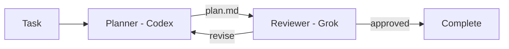

# Migent

**Compose AI coding agents into repeatable engineering workflows.**

Use the right model for each stage of the job.

Migent connects coding-agent CLIs from different providers through explicit,
repository-defined workflows. One model can plan, another can review, and the
first can revise—while Migent carries artifacts between them and remembers
where the process is.

## Contents

- [Migent](#migent)
  - [Contents](#contents)
  - [Why Migent?](#why-migent)
  - [Supported CLIs](#supported-clis)
  - [Quickstart](#quickstart)
    - [Install](#install)
    - [Upgrade](#upgrade)
    - [Create a project](#create-a-project)
    - [Run](#run)
  - [Concepts](#concepts)
  - [Current scope](#current-scope)
  - [Documentation](#documentation)
  - [Development](#development)
  - [License](#license)

## Why Migent?

Calling two agent CLIs from a shell script is easy. Reliably coordinating them
across reviews, revisions, failures, and resumed sessions is not.

Migent is built around three ideas:

- **Use models for what they do best.** Assign each role to a provider and model
  suited to the work, rather than asking one agent to do everything.
- **Treat AI engineering process as code.** Keep stages, handoffs, review gates,
  and revision policies in version control beside the project they govern.
- **Keep orchestration explicit.** The team defines the process; models execute
  roles inside it. A supervisor model does not invent or dynamically control
  the workflow.

**Models describe execution. Roles describe intent.** Changing the model behind
a role does not require rewriting the workflow.

**Common workflow model, native provider capabilities.** Migent coordinates
the process, while each provider CLI remains responsible for authentication,
agent execution, and its own tools and options.



## Supported CLIs

Migent drives each provider through its headless CLI. Install and sign in to the
ones your configuration names.

| Provider | CLI      |
| -------- | -------- |
| Claude   | `claude` |
| Codex    | `codex`  |
| Grok     | `grok`   |

## Quickstart

Node.js 22+ on macOS or Linux, and authenticated provider CLIs named by your
configuration.

### Install

```bash
npm install -g migent
```

Verify with `migent --version`.

### Upgrade

```bash
npm install -g migent@latest
```

### Create a project

From the project where agents will work:

```bash
migent init --preset plan
```

`init` writes the config, a plan-and-review workflow, and a gitignore for local
session state:

```text
.migent/
├── config.yaml
├── .gitignore
└── workflows/
    └── plan.yaml
```

In a terminal, pick the provider, model, and prompted options from the lists.
Pass `--provider` and `--model` together when input is not a terminal. Commit
`config.yaml` and `workflows/`. Leave `.migent/sessions/` untracked.

Model and role shape is in [Providers and model configuration](https://github.com/nodeint/migent/blob/main/docs/providers.md).
A full plan workflow is in [Writing workflows](https://github.com/nodeint/migent/blob/main/docs/workflows.md#complete-example).

### Run

From that project or any of its subdirectories:

```bash
migent start plan --task "Plan the account settings redesign"
```

Migent runs the next eligible stage until the workflow completes or stops.
Progress goes to stderr. Stdout is one JSON result.

```bash
migent sessions
migent watch <session-id>
migent continue <session-id>
```

Command fields and exit codes are in
[CLI commands and execution controls](https://github.com/nodeint/migent/blob/main/docs/cli.md). Session files are in
[Sessions and workflow composition](https://github.com/nodeint/migent/blob/main/docs/sessions.md).

## Concepts

A workflow connects stages through dependencies and explicit decision routes.

- A **model** identifies a provider model and its execution options.
- A **role** names a kind of work and selects its default model.
- A **stage** assigns work to a role and may declare dependencies, an artifact,
  a decision, or both.
- An **artifact** is a named file produced by a successful stage and stored with
  the workflow session.
- A **decision** selects the next route, including a route back for revision.
- A **session** records executions, events, decisions, and artifacts so work can
  be inspected or resumed.

Use `depends_on` to give a stage upstream artifacts. Use `session.resume_from`
when the stage must also continue a provider's prior conversational session.

## Current scope

Migent is a local, file-backed orchestration layer for provider CLIs. It does
not replace their agent runtimes, and it does not hide their distinctive
capabilities behind a lowest-common-denominator API.

Today, Migent supports explicit stage routing, review loops, local session
history, provider-session resume, prerequisite workflows, and standalone role
execution. A machine-local registry service records workspaces
so another tool can ask which projects exist.

## Documentation

- [Writing workflows](https://github.com/nodeint/migent/blob/main/docs/workflows.md)
- [Providers and model configuration](https://github.com/nodeint/migent/blob/main/docs/providers.md)
- [Sessions and workflow composition](https://github.com/nodeint/migent/blob/main/docs/sessions.md)
- [CLI commands and execution controls](https://github.com/nodeint/migent/blob/main/docs/cli.md)

Run `migent <command> --help` for the exact command contract, output fields,
and exit codes.

## Development

The pnpm workspace contains four packages: the `migent` CLI and its internal
libraries `@migent/kernel`, `@migent/adapters`, and `@migent/registry`. The
libraries have no stable API; depend on `migent`.

```bash
pnpm install
pnpm build
pnpm test
pnpm migent --help   # run the local build
```

Releases publish all four packages with `pnpm release`, which builds, tests,
and runs `pnpm -r publish` so `workspace:*` ranges become real versions.

## License

Migent is licensed under the [MIT License](https://github.com/nodeint/migent/blob/main/LICENSE).
