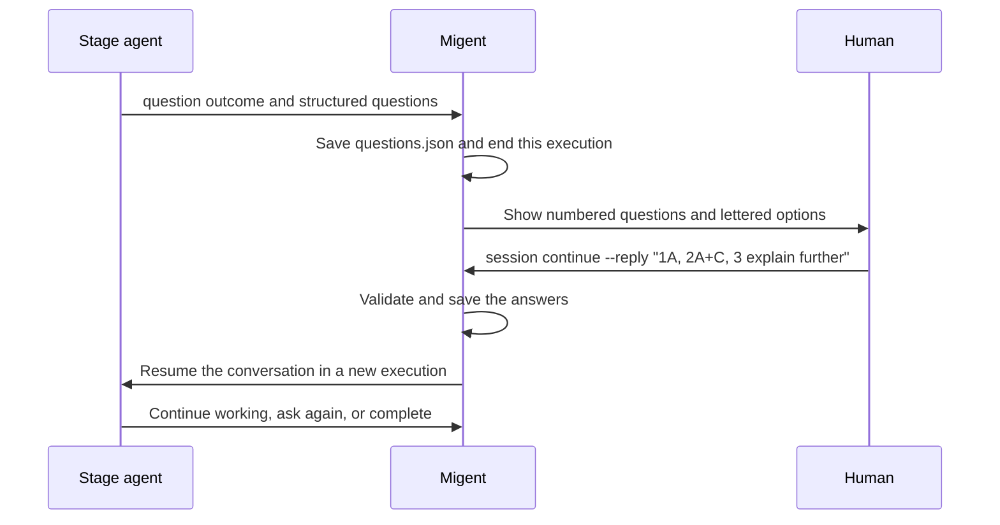

# Human-in-the-loop interaction

Migent lets an agent pause its work to ask a person for information or a
decision, save the answer, and continue the same conversation. This is called
**human-in-the-loop** interaction.

Questions belong to the stage doing the work. A planner can ask about scope,
a developer can ask about conflicting requirements, and a reviewer can ask
about acceptance criteria. A question does not need a separate workflow stage.

## Enable questions

Add `ask: human` to each stage that may ask questions. The role must already be
configured in `.migent/config.yaml`.

```yaml
schema_version: 4
id: plan
stages:
  - id: plan
    role: planner
    ask: human
    instructions:
      - Read task.md and the relevant code, then write plan.md.
      - Ask the user when the task leaves a scope or behavior decision unresolved.
    produces:
      artifact: plan.md
outputs:
  - name: plan
    from_stage: plan
    artifact: plan.md
```

`ask` selects the recipient. Currently its only supported value is `human`.
Omitting it disables questions for that workflow stage. Stages that only run
verification commands cannot ask questions. Agent or role recipients such as
`ask: jev` are not implemented.

A standalone role session can also ask the human without workflow configuration:

```bash
migent session run --role planner --prompt "Plan support for existing sessions"
```

## What happens when an agent asks



The CLI prints the questions and exits with code **9** when it stops for an
answer. It returns control to the terminal; it does not open an interactive
selection menu inside `run`.

A question ends the current execution, but the stage remains unfinished.
Stages depending on it wait. Independent branches can keep running before the
workflow command returns.

Continuing without a reply leaves unanswered questions pending. The agent does
not automatically choose a recommended option.

## Read and answer questions

Start a workflow normally:

```bash
migent session run --workflow plan --task "Plan support for existing sessions"
```

For a batch of three questions, the question portion of the output can look like:

```text
[migent] questions: .migent/sessions/<session-id>/questions.json
[migent] 1. Should existing sessions be supported? (choose one; stage plan)
Existing sessions require migration.
  A. New sessions only (recommended)
  B. Include existing sessions
  A free-text answer is always allowed.
  Answer: 1A or 1 <free text>.
[migent] 2. Which platforms should be supported? (choose one or more; stage plan)
Select the platforms the plan must cover.
  A. Linux
  B. Windows
  C. macOS
  A free-text answer is always allowed.
  Answer: 2A+B or 2 <free text>.
[migent] 3. How should migration run? (choose one; stage plan)
The agent needs a migration policy before finishing the plan.
  A. Automatically
  B. Manually
  A free-text answer is always allowed.
  Answer: 3A or 3 <free text>.

Reply with:
migent session continue <session-id> --stage plan --reply "<answer>"
```

Migent assigns question numbers `1`, `2`, `3`, ... and option letters `A`, `B`,
`C`, ... by order. Numbering restarts for each stage's new batch.

```bash
migent session continue <session-id> --stage plan --reply "1A, 2A+C, 3 unclear - explain further"
```

This selects A for question 1, selects A and C for question 2, and sends a
free-text answer for question 3. The agent receives all three answers and can
ask a follow-up question if more explanation is needed.

| Reply | Meaning |
| --- | --- |
| `1A` | Choose A for question 1. |
| `2A+C` | Choose A and C for question 2, which must permit multiple selections. |
| `3 unclear - explain further` | Answer question 3 with free text. |

Letters are case-insensitive. Separate answers with commas or newlines. For
a batch containing just one question, a bare letter, `A+C`, or free text also
works. Free-text answers are always allowed, including for multiple-choice
questions; they replace the option selection for that question.

Every question in the selected stage's batch must have an answer. Invalid
numbered selections, repeated entries, or incomplete batches are rejected
before the agent resumes. A `single` question accepts exactly one option; a
`multiple` question accepts one or more distinct options.

For long answers or programs, save the following JSON as `answers.json`:

```json
{
  "1": "A",
  "2": ["A", "C"],
  "3": "unclear - explain further"
}
```

```bash
migent session continue <session-id> --stage plan --reply-file answers.json
```

The JSON form is also useful when free text contains a comma followed by text
that looks like another numbered answer. It keeps the answer boundaries explicit.

## Running Migent yourself or through an agent

Migent uses the same question protocol whether a human or another agent calls
the CLI. The `ask` recipient determines who should make the decision.

| Caller | Handling a question with `ask: human` |
| --- | --- |
| Human at the terminal | Read the printed questions, then run `continue` with the answers. |
| Agent operating Migent | Read `questions.json` or `session show --json`, present the questions and options to the user, then pass their answers to `continue`. |

An agent operating Migent preserves the human's decision. A recommendation in
the question is not permission to answer on the user's behalf.

Use `--stage` when more than one stage can receive a reply, including stages
with blockers. Numbers identify questions within that stage's current batch.

## Questions, blockers, and workflow decisions

| Outcome | Meaning | Next action |
| --- | --- | --- |
| `question` | The agent needs information or a decision from the human. | Supply an answer with `--reply` or `--reply-file`. |
| `blocked` | An obstacle prevents further work, such as a missing resource or an error the agent cannot resolve. | Resolve the obstacle, then continue; a reply can provide additional information. |
| `complete` with a `decision` | The stage has finished and selected a workflow route. | Migent follows the declared route. |

A command error that the agent can still fix does not require a blocker. An
answer such as "approved" does not automatically set `decision: approved`;
the agent continues its work and reports the stage's outcome separately.

While work is running or ready, the session remains `active`. When no work can
run, the session is `blocked` if any stage has a blocker, otherwise `question`
if an answer is pending. Pending questions remain visible in either case.
A workflow stopped by a blocker exits 1; one stopped for answers exits 9.
For `--once` or `--stage`, a selected execution that asks questions exits 9 even
if another branch determines the overall session status. Successful inspection
commands such as `session show` exit 0.

## Files and question history

All files are under `.migent/sessions/<session-id>/`:

| File | Purpose |
| --- | --- |
| `questions.json` | Full question history across stages and rounds, with context, options, selection modes, statuses, and answers. |
| `executions/<execution-id>/questions.json` | Original question batch from that execution, with assigned numbers and letters. |
| `status.json` | Current snapshot; `questions` lists the pending questions. |
| `events.jsonl` | Session events, including the submitted reply and normalized answers. |

The session question file has `schema_version: 1` and a `questions` array.
Each record includes `id`, `question`, `context`, `selection`, `options`,
`stage_id`, `execution_id`, `recipient`, `status`, and `answer`.
Question status is `pending`, `answered`, or `superseded` when an unanswered
question is replaced by a later execution of that stage.

The pair `(execution_id, id)` identifies a question across rounds. For example,
question 1 in a follow-up execution is a different record from question 1 in
the first execution. Earlier questions and answers stay in the history.

Answers use one of these structures:

```json
{ "question_id": "1", "selected": ["A"] }
```

```json
{ "question_id": "3", "selected": [], "text": "unclear - explain further" }
```

The original agent response is also retained in `response.md`, but reading it
is unnecessary to obtain the structured questions. Use the CLI to submit
answers; do not edit generated session files. `session repair` can rebuild
question files from the saved execution outcomes and events.

## Agent response format

An agent asks by returning `status: question`, a blank line, and a JSON document:

```text
status: question

{
  "schema_version": 1,
  "questions": [
    {
      "question": "Should existing sessions be supported?",
      "context": "Existing sessions require migration.",
      "selection": "single",
      "options": [
        { "label": "New sessions only" },
        { "label": "Include existing sessions", "description": "Add a migration path." }
      ],
      "recommended": ["A"]
    }
  ]
}
```

Each question requires nonempty `question` and `context` strings, a `selection`
of `single` or `multiple`, and 2 to 26 options. Each option requires a nonempty
`label`; `description` is optional. Agents omit IDs so Migent assigns them.
If IDs are supplied, they must match the sequential numbers and letters.

Optional `recommended` contains distinct option letters. It permits at most
one entry for a `single` question and never supplies an answer automatically.
The document can contain several questions. Migent validates the complete
document before accepting the question outcome.

## Resume and verification

After an answer, Migent creates a new execution and continues the same
provider conversation. It carries forward the declared working artifact and
passes the normalized answers, including selected option labels or free text.
The answer is saved before dispatch so it can be recovered if dispatch is
interrupted before the next execution is created.

Asking does not count as a workflow revision or run verification commands.
The agent can ask during a verification repair turn; previous failures still
count toward `max_verify` after the reply. The agent must report `complete`
again, and the full verification list must pass before the stage can finish.

For workflow configuration, see [Writing workflows](workflows.md). For session
inspection, recovery, and frozen configuration, see [Sessions](sessions.md).
